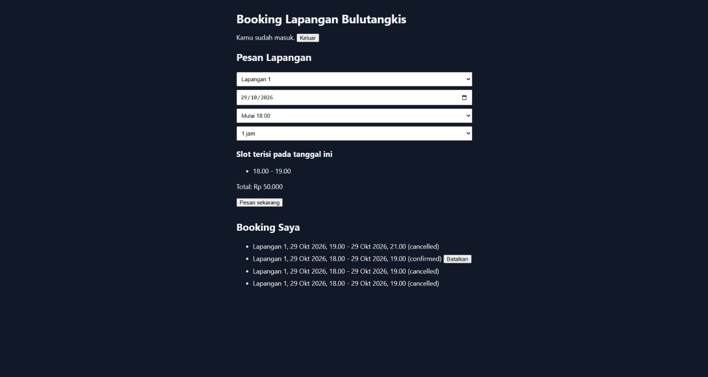
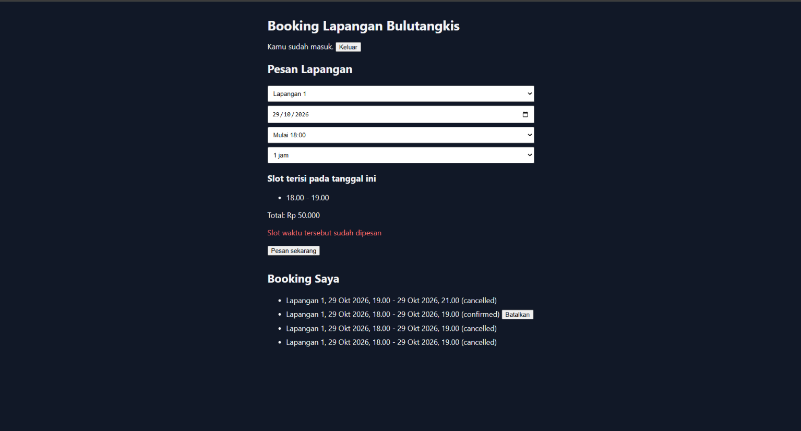
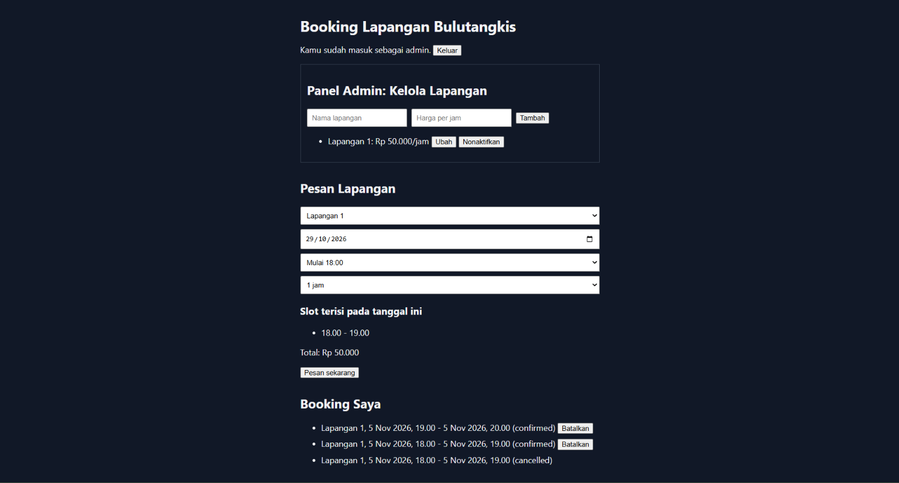
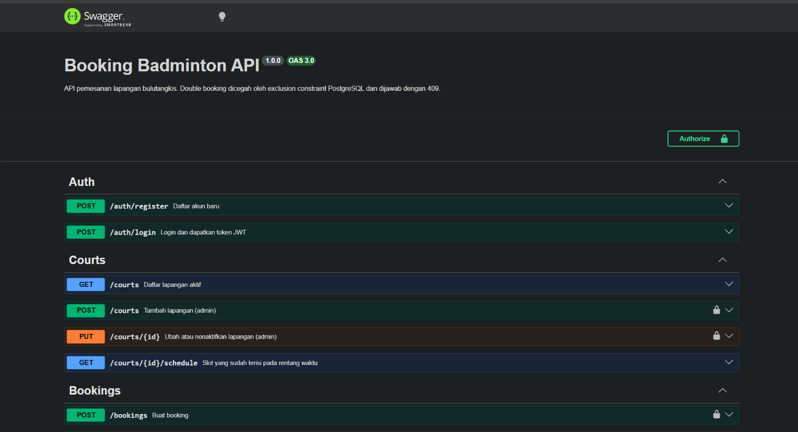
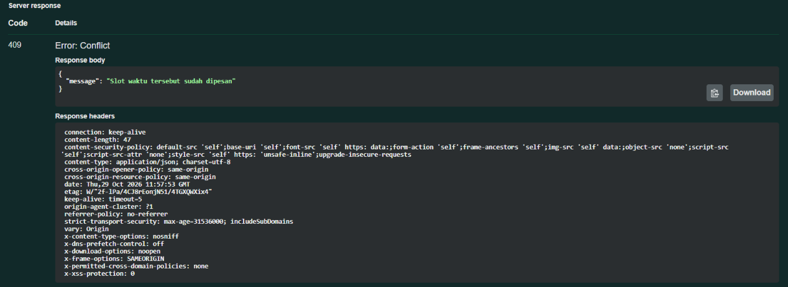

# Booking Badminton API


REST API untuk sistem pemesanan lapangan bulutangkis. Pelanggan bisa melihat jadwal dan memesan lapangan, admin mengelola lapangan. Fokus utamanya: **mencegah double booking**, bahkan saat banyak permintaan masuk bersamaan.

## Teknologi

Node.js, TypeScript, Express, PostgreSQL, JWT, bcrypt, Vitest + Supertest, Docker, GitHub Actions

## Cara menjalankan

Butuh Docker dan file `.env` berisi `JWT_SECRET=isi_acak_anda`.

```bash
docker compose up --build
```

API tersedia di `http://localhost:3001`.

## Endpoint

| Method | Path | Akses | Fungsi |
|--------|------|-------|--------|
| POST | /auth/register | Publik | Daftar akun |
| POST | /auth/login | Publik | Login, mengembalikan token JWT |
| GET | /courts | Publik | Daftar lapangan aktif |
| POST | /courts | Admin | Tambah lapangan |
| PUT | /courts/:id | Admin | Ubah atau nonaktifkan lapangan |
| GET | /courts/:id/schedule | Publik | Jadwal terisi (`?from=&to=`) |
| POST | /bookings | Login | Buat booking |
| GET | /bookings/me | Login | Riwayat booking sendiri |
| PATCH | /bookings/:id/cancel | Login | Batalkan booking (admin bisa semua) |

## Mencegah double booking

Pengecekan "slot kosong?" di kode aplikasi bisa kebobolan kalau dua permintaan datang bersamaan. Karena itu aturannya dipasang langsung di database dengan exclusion constraint PostgreSQL:

```sql
EXCLUDE USING gist (
  court_id WITH =,
  tstzrange(start_time, end_time) WITH &&
) WHERE (status = 'confirmed')
```

Database menolak dua booking aktif yang waktunya tumpang tindih di lapangan yang sama, dan API mengubahnya menjadi respons `409 Conflict`. Booking yang dibatalkan tidak dihitung, jadi slotnya bisa dipesan ulang. Ada test otomatis yang mengirim 5 permintaan serentak ke slot yang sama: hanya satu yang berhasil.

## Contoh penggunaan

Booking pertama berhasil:

```bash
curl -X POST http://localhost:3001/bookings \
  -H "Content-Type: application/json" \
  -H "Authorization: Bearer <token>" \
  -d '{"court_id":1,"start_time":"2026-11-05T18:00:00+08:00","end_time":"2026-11-05T19:00:00+08:00"}'
```
Respons `201 Created`:
```json
{"id":1,"user_id":1,"court_id":1,"status":"confirmed", ...}
```

Mengulang request yang sama ditolak oleh database:

Respons `409 Conflict`:
```json
{"message":"Slot waktu tersebut sudah dipesan"}
```

## Pengujian

```bash
npm test
```

Test memakai database terpisah (`booking_test`) dan berjalan otomatis di GitHub Actions setiap push.

## Rencana berikutnya

- Pembayaran (Midtrans sandbox)
- Notifikasi email

## Tampilan






